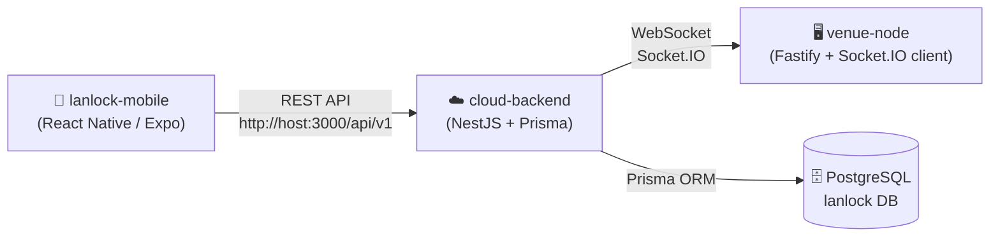

# LanLock — Project Status Report

> **"LanLock"** is a gaming café / LAN venue management system with a 3-tier architecture: **Mobile App → Cloud Backend → Venue Node**.

---

## Architecture Overview

---

## 1. Cloud Backend (`cloud-backend/`)

| Aspect | Status |
|---|---|
| **Framework** | NestJS (v11) + TypeScript |
| **Database** | PostgreSQL 16 via Prisma ORM (v7) with `@prisma/adapter-pg` |
| **API Prefix** | `/api/v1` |
| **Docker** | ✅ Dockerfile + docker-compose.yml (app + postgres) |

### Modules Built

| Module | Files | What It Does |
|---|---|---|
| **PrismaModule** | [prisma.service.ts](file:///d:/Anurag Rai/LAN/cloud-backend/src/prisma/prisma.service.ts), [prisma.module.ts](file:///d:/Anurag Rai/LAN/cloud-backend/src/prisma/prisma.module.ts) | Global database service — connects via `pg.Pool` + Prisma adapter |
| **HealthModule** | [health.controller.ts](file:///d:/Anurag Rai/LAN/cloud-backend/src/health/health.controller.ts) | `GET /api/v1/health` → `{ status: 'ok', service: 'lanlock-cloud' }` |
| **EventsModule** | [events.gateway.ts](file:///d:/Anurag Rai/LAN/cloud-backend/src/events/events.gateway.ts) | WebSocket gateway — sends `PING` on connect, handles `PONG` response |
| **InventoryModule** | [inventory.controller.ts](file:///d:/Anurag Rai/LAN/cloud-backend/src/inventory/inventory.controller.ts), [inventory.service.ts](file:///d:/Anurag Rai/LAN/cloud-backend/src/inventory/inventory.service.ts) | `GET /api/v1/inventory` → lists all PCs with name, specs, status |

### Database Schema ([schema.prisma](file:///d:/Anurag Rai/LAN/cloud-backend/prisma/schema.prisma))

| Model | Key Fields | Notes |
|---|---|---|
| **Venue** | `id`, `name`, `location` | A gaming café location |
| **PCNode** | `id`, `name`, `specs`, `status` (enum: ONLINE/OFFLINE/IN_USE/MAINTENANCE) | Individual gaming PC, belongs to a Venue |
| **Session** | `id`, `userId`, `pcNodeId`, `startTime`, `endTime`, `status` (ACTIVE/COMPLETED/CANCELLED) | A gaming session on a PC |

### Seed Data ([seed.ts](file:///d:/Anurag Rai/LAN/cloud-backend/prisma/seed.ts))
- 1 Venue: **"LanLock Delhi-North"**
- 5 PCs: A-01 through A-05 (mix of RTX 3060, RTX 4090, Standard)

---

## 2. Venue Node (`venue-node/`)

| Aspect | Status |
|---|---|
| **Framework** | Fastify (v5) |
| **Role** | Lightweight edge server running at a physical venue |

### What It Does ([server.js](file:///d:/Anurag Rai/LAN/venue-node/server.js))
- ✅ Connects to cloud backend via **Socket.IO client** (WebSocket)
- ✅ Responds to `events.server.PING` with `events.client.PONG`
- ✅ Auto-reconnection with infinite retries
- ✅ `GET /health` endpoint showing venue node + cloud connection status
- ✅ Custom error & 404 handlers
- Listens on port **8080**

---

## 3. Mobile App (`lanlock-mobile/`)

| Aspect | Status |
|---|---|
| **Framework** | React Native (0.74.5) + Expo SDK 51 |
| **Styling** | NativeWind (TailwindCSS for RN) + plain StyleSheet |
| **Navigation** | React Navigation (Stack) |
| **HTTP Client** | Axios (via [client.js](file:///d:/Anurag Rai/LAN/lanlock-mobile/src/api/client.js)) |
| **Theme** | Valorant-inspired dark theme (dark blue `#0F1923` + red accent `#FF4655`) |

### Screens Built

| Screen | File | What It Does |
|---|---|---|
| **HomeScreen** | [HomeScreen.js](file:///d:/Anurag Rai/LAN/lanlock-mobile/src/screens/HomeScreen.js) | Fetches & displays PC inventory as cards (name, specs, availability). Pull-to-refresh. FAB button to navigate to Scan screen. |
| **ScanScreen** | [ScanScreen.js](file:///d:/Anurag Rai/LAN/lanlock-mobile/src/screens/ScanScreen.js) | QR code scanner using `expo-camera`. Shows camera with a red-bordered cutout viewfinder. Permission handling included. |

### API Layer

| File | Purpose |
|---|---|
| [client.js](file:///d:/Anurag Rai/LAN/lanlock-mobile/src/api/client.js) | Axios instance → `http://10.0.2.2:3000/api/v1` (Android emulator) |
| [index.js](file:///d:/Anurag Rai/LAN/lanlock-mobile/src/api/index.js) | Fetch-based API client (alternate, not actively used) |
| [inventory.js](file:///d:/Anurag Rai/LAN/lanlock-mobile/src/api/inventory.js) | `fetchInventory()` — calls `GET /inventory` via Axios |

---

## What's Done ✅

| Area | Completed |
|---|---|
| **Project scaffolding** | All 3 projects initialized with dependencies installed |
| **Database design** | Venue → PCNode → Session schema with enums |
| **Database seeding** | 1 venue + 5 PCs |
| **REST API** | Health check + Inventory listing endpoints |
| **WebSocket layer** | Cloud ↔ Venue Node PING/PONG heartbeat |
| **Docker setup** | Full docker-compose for backend + PostgreSQL |
| **Mobile navigation** | Stack navigator with Home + Scan screens |
| **Inventory UI** | Cards showing PC name, specs, availability status with pull-to-refresh |
| **QR Scanner UI** | Camera permission handling + viewfinder overlay |
| **Design system** | Valorant-inspired dark theme with consistent color palette |

---

## What's NOT Done Yet ❌

| Area | Missing |
|---|---|
| **Authentication** | No user auth (login/signup/JWT/OAuth) — `Session.userId` is a plain string with no User model |
| **User model** | No `User` table in the database |
| **QR code processing** | Scanner UI exists but `onBarcodeScanned` handler is NOT wired — scanning does nothing |
| **Session management** | Session model exists in schema but NO endpoints to create/start/end sessions |
| **Venue CRUD** | No API endpoints to manage venues |
| **PC status updates** | No mechanism to change PC status (ONLINE/OFFLINE/IN_USE) |
| **Venue Node intelligence** | Only does PING/PONG — no real PC monitoring, session management, or local logic |
| **Real-time updates** | WebSocket exists but no events for status changes pushed to mobile app |
| **Payments / Billing** | No pricing, time tracking, or payment integration |
| **Admin panel** | No web dashboard for venue owners |
| **Environment configs** | Mobile app has hardcoded `10.0.2.2` — no env-based config switching |
| **Error handling in mobile** | Errors are only `console.error`'d — no user-facing error states |
| **Tests** | Default NestJS test file exists, but no real test coverage |
| **Migrations** | Prisma migrations directory exists but unclear if first migration has been run |

---

> [!TIP]
> The project has a solid foundation with all three tiers scaffolded and connected. The **next logical steps** would be: wiring the QR scanner to actually start sessions, adding user authentication, and building out session management APIs.
